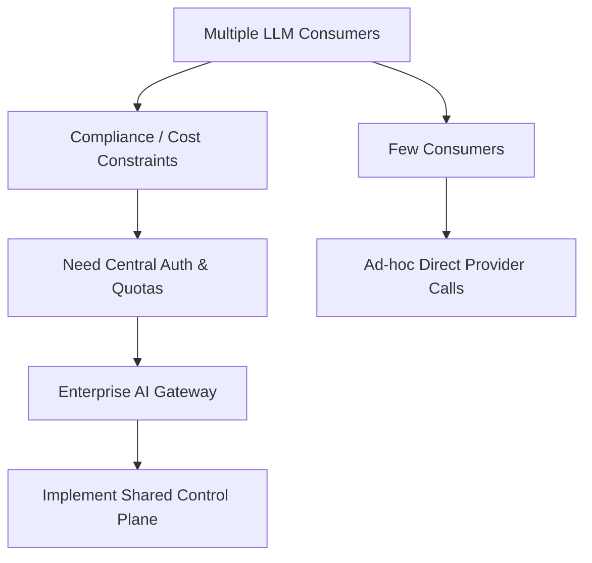

# Enterprise AI Gateway – Technical Guide  

*A control‑plane that authenticates, routes, and governs every LLM request across an organization.*

---

## 📋 Diagnosis Table  

| Symptom | Likely Root Cause | When a Gateway Becomes Worthwhile |
|---|---|---|
| Sprawl of API keys | Each team provisions its own provider credentials | Multiple independent consumer services and/or a mix of cloud providers |
| Unpredictable monthly LLM spend | No centralized quota enforcement | Organization needs centralized budgeting and cost‑center accountability |
| Inconsistent policy enforcement (e.g., PII leakage) | Policy logic duplicated in many services | Regulatory or legal policies must be auditable enterprise‑wide |
| Latent or failed model calls during peak loads | No fail‑over or routing logic | Strong service‑level expectations for availability and response time |
| Difficulty onboarding a new foundation model | Hard‑coded provider URLs in code | A central “allow‑list” of approved models is required |

---

## 🗺️ Decision Diagram  



*If the left‑hand path is taken, a gateway is strongly recommended. The right‑hand path may remain viable for very small deployments.*

---

## 🏗️ Architecture & Responsibility Matrix  

| Layer | Responsibility | Typical Implementation Details |
|---|---|---|
| **Authentication** | Verify caller identity (API‑key, JWT, mTLS). | Use corporate IdP (Azure AD, Okta). Map identities → tenants → quota buckets. |
| **Quota & Throttling** | Enforce per‑team, per‑product, and per‑model limits. | Token‑bucket or leaky‑bucket counters stored in a fast cache (Redis, Azure Cache). |
| **Routing** | Select provider & model based on policy, latency, cost, or feature set. | Rule engine (e.g., JSON‑based policy) that evaluates `preferredProvider`, `fallbackProvider`, `region`. |
| **Policy Enforcement** | Apply legal/ethical guardrails (PII redaction, hate‑speech blocking, regulated exposure caps). | Plug‑in filters that run before request reaches the model; can short‑circuit with a “blocked” response. |
| **Logging & Auditing** | Capture request metadata, decisions, and outcomes for compliance dashboards. | Structured logs (JSON) streamed to SIEM/Log Analytics; include request ID, caller, model, policy decisions. |
| **Provider Abstraction** | Hide vendor‑specific SDKs behind a uniform interface. | Internal `ModelClient` with methods `invoke(prompt, params)` that internally selects Azure OpenAI, AWS Bedrock, etc. |
| **Failover** | Detect degraded latency or error rates and transparently switch to a secondary provider. | Health‑check ping; routing rule `if latency deteriorates → use fallback`. |
| **Model Allow‑list** | Central catalog of approved foundation models (name, version, vendor, licensing). | Single source of truth (e.g., Azure Table, DynamoDB) referenced during routing. |

---

## 🐍 Python Decision Helper (Standard Library Only)  

> **Teaching‑only** – The snippet demonstrates how a service could decide whether to invoke the gateway or fall back to a direct provider, based solely on a configuration file.

```python
# enterprise_ai_gateway_helper.py
"""
Decision helper for routing LLM requests.

- Reads a JSON config that contains:
    * `allow_list`: approved model identifiers
    * `quota_limits`: per‑tenant request caps
    * `fallback_provider`: secondary cloud vendor
- Returns a dict with routing metadata; raises AssertionError on mis‑configuration.
"""

import json
import os
from pathlib import Path
from typing import Dict, Any

CONFIG_PATH = Path(os.getenv("GATEWAY_CONFIG", "./gateway_config.json"))

def load_config() -> Dict[str, Any]:
    """Load and validate the gateway configuration."""
    with CONFIG_PATH.open() as fp:
        cfg = json.load(fp)

    # Basic sanity checks – deterministic assertions, not runtime heuristics.
    assert isinstance(cfg.get("allow_list"), list), "allow_list must be a list"
    assert cfg.get("allow_list"), "allow_list cannot be empty"
    assert isinstance(cfg.get("quota_limits", {}), dict), "quota_limits must be a dict"
    assert isinstance(cfg.get("fallback_provider"), str), "fallback_provider required"
    return cfg

def decide_routing(tenant_id: str, requested_model: str, current_usage: int) -> Dict[str, str]:
    """
    Determine the provider and model to use.

    Parameters
    ----------
    tenant_id: str – Identifier of the calling team/product.
    requested_model: str – Model name requested by the caller.
    current_usage: int – Number of requests already made this billing period.

    Returns
    -------
    dict with keys `provider`, `model`, `via_gateway`.
    """
    cfg = load_config()

    # Enforce allow‑list
    assert requested_model in cfg["allow_list"], f"Model {requested_model} not approved"

    # Enforce quota (simple per‑tenant cap)
    quota = cfg["quota_limits"].get(tenant_id, 0)
    assert quota > 0, f"No quota defined for tenant {tenant_id}"
    assert current_usage < quota, f"Tenant {tenant_id} exceeded quota ({current_usage}/{quota})"

    # Routing decision – primary provider derived from model name convention
    primary_provider = "azure" if requested_model.lower().startswith("gpt") else "aws"

    # In a real deployment the health check would be dynamic; here we assume primary is healthy.
    provider = primary_provider

    # Example of deterministic fail‑over logic (placeholder)
    # if health_check(provider) == "unhealthy":
    #     provider = cfg["fallback_provider"]

    return {
        "provider": provider,
        "model": requested_model,
        "via_gateway": "true",  # All decisions flow through the gateway
    }

# Example usage (for illustration only)
if __name__ == "__main__":
    # Simulate a request from team 'risk‑engine' asking for 'gpt-4o-mini' with 12 prior calls.
    routing = decide_routing("risk-engine", "gpt-4o-mini", 12)
    print(routing)
```

---

## 📄 Illustrative Architecture Decision Records  

### ADR 1 – Adopt Central Model Allow‑List  

**Context**  
Multiple engineering squads independently select foundation models. Procurement data shows several distinct model versions in production, leading to fragmented licensing and security reviews.  

**Decision**  
Introduce a **central allow‑list** stored in a managed key‑value service. The gateway validates every request against this list before routing.  

**Consequences**  

| Positive | Negative |
|---|---|
| Single source of truth for compliance and licensing. | Requires coordination for model deprecation or addition. |
| Faster onboarding of new services (they inherit the list). | Slight increase in request latency due to the lookup. |

**Acceptance Criteria**  

- All production LLM calls should be validated by the gateway before reaching a provider.  
- Requests for models not present in the allow‑list are rejected with an appropriate error response.  
- Auditors can retrieve a read‑only JSON snapshot of the allow‑list via a dedicated API.  

**Uncertainties**  

- Frequency of model version churn may pressure the update process.  
- Impact on latency for high‑throughput micro‑services needs monitoring.  

---

### ADR 2 – Implement Provider‑Failover Policy  

**Context**  
During a load test, Azure OpenAI latency spiked markedly, breaching internal availability expectations. No automatic reroute existed, leading to request timeouts.  

**Decision**  
Encode a **fail‑over rule** in the gateway: if the primary provider’s recent latency exceeds an acceptable threshold, automatically route new requests to the secondary provider defined in `fallback_provider`.  

**Consequences**  

| Positive | Negative |
|---|---|
| Improves resilience without code changes in downstream services. | Requires reliable health‑monitoring infrastructure. |
| Enables cost optimisation by preferring lower‑priced providers when performance is acceptable. | Possible model‑output variance between providers; downstream must tolerate it. |

**Acceptance Criteria**  

- Health monitoring must emit latency metrics to a central store at regular intervals.  
- Fail‑over activation must be logged with timestamp, measured latency, and chosen provider.  
- After latency improves and remains within acceptable bounds for a sustained period, routing should revert to the primary provider.  

**Uncertainties**  

- How downstream services will handle subtle differences in tokenisation or response format between providers.  
- Potential licensing implications of dynamically switching providers mid‑request.  

---

## ✅ Evaluation & Maintenance Checklist  

- [ ] **Authentication Review** – Verify token validation against the corporate IdP on a quarterly cadence.  
- [ ] **Quota Accuracy** – Reconcile gateway counters with cloud billing reports each month.  
- [ ] **Policy Coverage** – Run an automated test suite that injects known PII, regulated terms, and profanity; ensure the gateway blocks or redacts as expected.  
- [ ] **Latency & Fail‑over Tests** – Simulate provider latency degradation; confirm automatic reroute and proper logging.  
- [ ] **Allow‑list Audits** – Generate a weekly immutable snapshot; compare against procurement records for consistency.  
- [ ] **Log Retention & Access Control** – Ensure logs are encrypted at rest and retained for the mandated compliance period.  
- [ ] **Disaster Recovery Drill** – Power‑cycle the gateway service and verify that downstream services handle the temporary unavailability according to the defined fallback strategy.  
- [ ] **Cost Monitoring** – Correlate gateway‑reported usage with cloud billing dashboards; investigate any significant variance.  

---

## 📚 References  

1. **Microsoft RAG concepts** – Retrieval‑augmented generation overview for Azure AI services. <https://learn.microsoft.com/en-us/azure/foundry/concepts/retrieval-augmented-generation>  
2. **LoRA paper** – Low‑Rank Adaptation of Large Language Models. <https://arxiv.org/abs/2106.09685>  

---  

*This guide is intended for architects and platform engineers evaluating the trade‑offs of an Enterprise AI Gateway. Adoption decisions should be driven by measurable compliance, cost, and resilience signals rather than assumed performance gains.*
