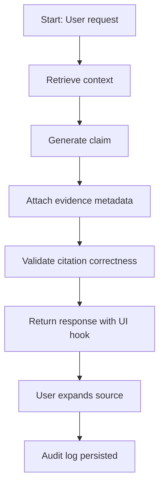

# Evidence‑First Generation & Citations  

## Diagnosis Table  

| Symptom                                   | Likely Cause                                   | Immediate Mitigation                                   |
|-------------------------------------------|-----------------------------------------------|----------------------------------------------------------|
| Model hallucinates a numeric policy limit | Claim generated without attached source metadata | Enforce claim‑to‑evidence mapping in the generation step |
| UI shows only a confidence score         | UI layer decoupled from retrieval‑metadata      | Bind “show source” widget directly to stored evidence      |
| Auditors cannot trace a recommendation    | Immutable citation metadata not persisted       | Persist timestamp, doc‑ID, version, and excerpt together with response |
| Live regulatory numbers are stale        | Numeric values retrieved from static docs       | Delegate live values to a deterministic API (Live‑Value Service) |
| Regression test failures after model update| Evidence bundle generated differently post‑update | Freeze evidence‑generation logic; run regression suite before releasing |

## Decision Diagram  



## Architecture & Responsibilities  

| Component | Responsibility |
|-----------|-----------------|
| **Prompt Engine** | Formats retrieved snippets, inserts citation placeholders (`<cite:ID>`). |
| **Retriever** | Returns documents with **source**, **version**, **location**, and a deterministic **confidence** score (no live numeric values). |
| **Citation Manager** | Builds an immutable evidence object (`doc_id`, `version`, `url`, `excerpt`, `retrieved_at`, `confidence`). |
| **Validator** | Ensures every generated claim has a matching evidence object; rejects missing or malformed citations. |
| **UI Layer** | Renders a “show source” action that expands the stored excerpt; never displays raw confidence scores alone. |
| **Audit Service** | Writes an immutable JSON log containing the full response, evidence bundle, request metadata, and, if applicable, live‑value API payloads. |
| **Live‑Value Service** | Provides authoritative, deterministic values (e.g., current prime rate) via a certified API; its output is consumed **after** evidence attachment and never stored as evidence. |
| **Business‑Rule Engine** | Applies deterministic code (e.g., “if LTV > 80 % then reject”) using the live‑value payload; never modifies evidence. |

> **Note:** Retrieval‑augmented generation (RAG) improves access to source material but does **not** guarantee factual correctness. Evidence must be validated, and any live‑value lookup must be performed separately from the retrieval step.

## Python Decision Helper (teaching‑only)

```python
import datetime
import json
from typing import Dict, List, Any

def make_evidence(doc_id: str, version: str, url: str, excerpt: str) -> Dict[str, Any]:
    """Create an immutable evidence record."""
    return {
        "doc_id": doc_id,
        "version": version,
        "url": url,
        "excerpt": excerpt,
        "retrieved_at": datetime.datetime.utcnow().isoformat() + "Z",
        "confidence": 1.0,   # deterministic retrieval confidence
    }

def map_claim_to_evidence(claim: str, evidence: Dict[str, Any]) -> Dict[str, Any]:
    """Attach a claim to its evidence; raise on mismatch."""
    assert isinstance(claim, str) and claim, "Claim must be a non‑empty string"
    assert evidence.get("doc_id"), "Evidence must contain a doc_id"
    return {"claim": claim, "evidence": evidence}

def validate_citations(response: List[Dict[str, Any]]) -> None:
    """Assert that every entry has a well‑formed evidence object."""
    for entry in response:
        assert "claim" in entry, "Missing claim field"
        ev = entry.get("evidence")
        assert ev and isinstance(ev, dict), "Missing evidence dict"
        for key in ("doc_id", "version", "url", "retrieved_at"):
            assert ev.get(key), f"Evidence missing required key: {key}"
    # No return – raise on failure; teaching‑only helper

# ----------------------------------------------------------------------
# Illustrative usage (hypothetical; not executed in production)
if __name__ == "__main__":
    ev = make_evidence(
        doc_id="FIN-REG-2023-07",
        version="v2.1",
        url="https://reg.example.gov/guidelines#ltv",
        excerpt="Maximum loan‑to‑value ratio is 80 % for conventional mortgages."
    )
    response = [map_claim_to_evidence("LTV limit = 80 %", ev)]
    validate_citations(response)
    print(json.dumps(response, indent=2))
```

## Architectural Decision Records (ADRs)  

### ADR 1 – Evidence Object Schema  
*Context* – Early prototypes stored only a URL; auditors could not reproduce the exact clause.  
*Decision* – Adopt a fixed JSON schema (`doc_id`, `version`, `url`, `excerpt`, `retrieved_at`, `confidence`).  
*Consequences*  
- **Pros** – Full traceability, easy diff across model releases.  
- **Cons** – Slight payload increase (~300 B per citation).  

### ADR 2 – Separation of Live‑Value Retrieval  
*Context* – Some calculations require the current prime rate, which changes hourly.  
*Decision* – Introduce a deterministic **Live‑Value Service** invoked **after** evidence attachment; its result is fed only to the business‑rule engine.  
*Acceptance Criteria*  
- An end‑to‑end test shows that mocking the live rate changes the final decision **but not** the stored evidence bundle.  
- Audit logs contain both the evidence bundle and the live‑value response, each with a reproducible request identifier.  

## Evaluation & Maintenance Checklist  

- **Evidence Coverage** – Track the proportion of generated claims that include a non‑empty evidence object; investigate any systematic gaps.  
- **Citation Correctness** – Run the validator nightly and log any mismatches for root‑cause analysis.  
- **Live‑Value Isolation** – Verify through integration tests that changes to live‑value responses do not affect the stored citation bundle.  
- **Version Drift** – Compare source document versions against a baseline weekly; flag any document older than the acceptable freshness window (e.g., 30 days).  
- **Latency Observation** – Record end‑to‑end latency before and after evidence attachment; monitor for unexpected spikes.  
- **Regulatory Audit** – Perform a quarterly manual review of a random sample of responses for compliance.  
- **Model Update Guardrail** – Before any model weight change, execute a regression suite that asserts evidence bundles remain consistent for a fixed query set.  

## References  

- **Microsoft RAG concepts** – <https://learn.microsoft.com/en-us/azure/foundry/concepts/retrieval-augmented-generation>  
- **LoRA: Low‑Rank Adaptation of Large Language Models** – <https://arxiv.org/abs/2106.09685>  
- **NIST GenAI Profile** – <https://csrc.nist.gov/projects/gen-ai>  
- **Azure RAG guidance** – <https://learn.microsoft.com/azure/ai-services/openai/concepts/retrieval-augmented-generation>  
- **OECD Learning Standards** – <https://www.oecd.org/education/learning-standards>  

*(All links are illustrative; replace with production‑ready URLs as needed.)*
