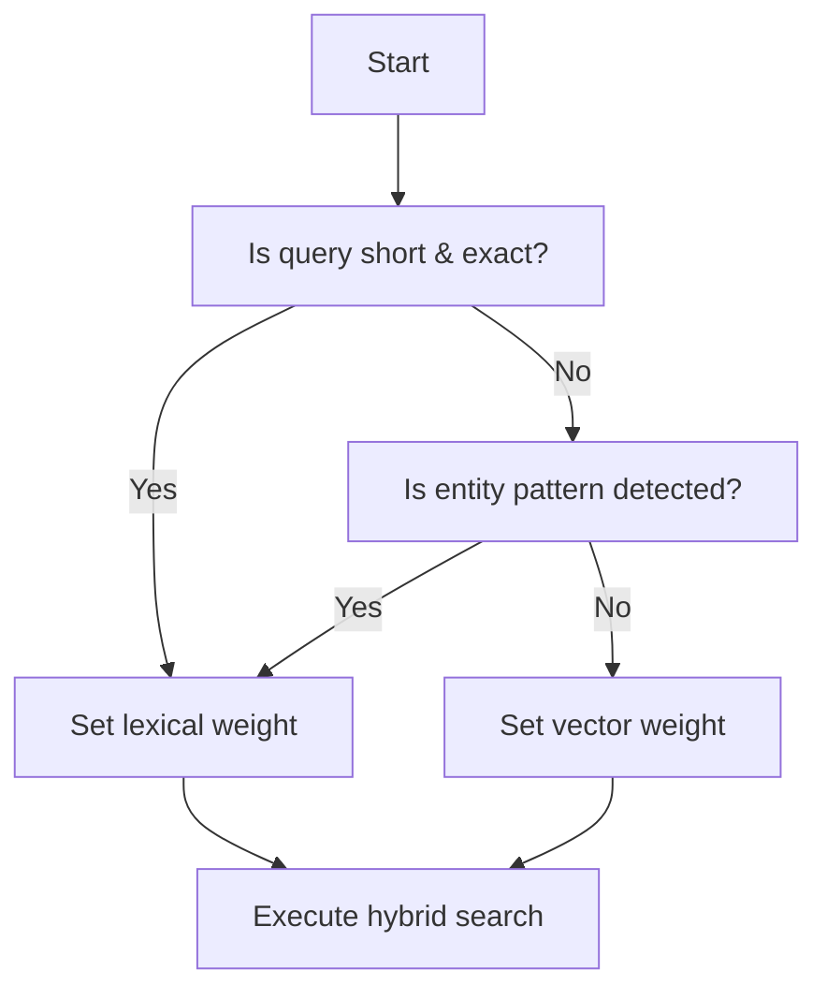

# Hybrid Search in Enterprise Retrieval: Lexical + Vector Fusion  

## Quick Diagnosis  

| Symptom | Likely Root Cause | Lexical (BM25) Impact | Dense Vector Impact | Immediate Action |
|---------|-------------------|----------------------|----------------------|------------------|
| *Exact phrase returns no hit* | Query terms missing in index or stop‑word removal | Low recall – exact match fails | Irrelevant – semantic similarity may surface loosely related docs | Verify analyzer pipeline, re‑index with phrase‑aware tokenizer |
| *Relevant documents missing despite synonyms* | Vocabulary mismatch, no semantic layer | Zero score (no token overlap) | May retrieve but low rank if weight is too low | Increase vector weight or add synonym expansion to index |
| *Legal compliance audit returns extra unrelated hits* | Over‑aggressive vector weighting | Still deterministic for exact hits | Introduces noise | Reduce vector contribution, add stricter metadata filter |
| *Entity identifiers (e.g., “ACC‑12345”) are not boosted* | No entity‑aware boosting rule | Matches exact token, but lower than surrounding text | Vector similarity may ignore numeric patterns | Add entity boost factor in scoring function |
| *Search latency spikes after hybrid enablement* | Unoptimized fusion step or large candidate set | Fast BM25 lookup | Cosine similarity on many vectors is expensive | Limit candidate pool, cache embeddings, tune top‑k per branch |

## Decision Flow (Mermaid)  



*The diagram guides weight selection before the hybrid request is issued.*

## Architecture & Responsibility Matrix  

| Component | Primary Responsibility | Owner (role) | Key Interfaces |
|----------|------------------------|--------------|----------------|
| **Lexical Index (BM25)** | Tokenization, posting list creation, deterministic scoring | Search Index Engineer | Query API, Document Ingestion Pipeline |
| **Vector Store** | Embedding generation (offline), approximate nearest‑neighbor (ANN) lookup, cosine similarity | ML Retrieval Engineer | Embedding Service, ANN Index |
| **Fusion Engine** | Combine BM25 score & vector similarity, apply entity boost, enforce metadata filters | Retrieval Architect | Scoring Service, Filter Service |
| **Metadata Filter Service** | Apply user‑defined constraints (date, department, product) before ranking | Data Governance Lead | Filter API, Access Control Layer |
| **Observability Layer** | Log latency, score distribution, drift in recall/precision | SRE / Analytics | Metrics Exporter, Alerting Rules |
| **Evaluation Harness** | Periodic QA against labeled queries, regression detection | QA Engineer | Test Suite, Benchmark Dashboard |

## Core Distinctions for Hybrid Retrieval  

1. **Current Knowledge** – Stored in the lexical index and vector store; it reflects the state of the document corpus at ingestion time.  
2. **Live Values** – Anything that must be obtained from an authoritative system (e.g., pricing API, compliance service) should be fetched via a dedicated tool or API at query time, not from the retrieved text.  
3. **Enforceable Business Rules** – Deterministic logic such as entity boosts, mandatory metadata filters, or compliance flags must live in code that guarantees execution for every request.  
4. **Tuning for Stable Behavior** – Adjustments to weight ratios, boost factors, or retrieval thresholds should be performed after systematic evaluation with labeled data and regression testing; they are not a substitute for the business rules above.

## Python Decision Helper (standard library only)  

```python
# teaching-only: illustrative helper to choose lexical/vector weights
import re
from typing import Dict

def decide_weights(query: str, has_entity: bool, metadata_filter: bool) -> Dict[str, float]:
    """
    Returns a weight map for hybrid search.

    - lexical weight + vector weight must sum to 1.0.
    - entity presence pushes lexical weight up.
    - metadata filtering favours lexical precision.

    Raises:
        AssertionError: if inputs are malformed or resulting weights are out of bounds.
    """
    # Basic sanity checks
    assert isinstance(query, str) and query.strip(), "query must be a non‑empty string"
    assert isinstance(has_entity, bool), "has_entity must be bool"
    assert isinstance(metadata_filter, bool), "metadata_filter must be bool"

    # Heuristic: short exact queries → strong lexical emphasis
    short_exact = len(query.split()) <= 3 and not re.search(r"\b(what|how|why)\b", query, re.I)

    # Base weights
    lexical = 0.6
    vector = 0.4

    if short_exact:
        lexical = 0.8
        vector = 0.2
    if has_entity:
        lexical = min(lexical + 0.1, 0.9)   # boost exact token match
        vector = 1.0 - lexical
    if metadata_filter:
        lexical = min(lexical + 0.05, 0.95) # filters favour deterministic hits
        vector = 1.0 - lexical

    # Final validation
    assert 0.0 <= lexical <= 1.0, "lexical weight out of range"
    assert 0.0 <= vector <= 1.0, "vector weight out of range"
    assert abs((lexical + vector) - 1.0) < 1e-6, "weights must sum to 1.0"

    return {"lexical": lexical, "vector": vector}
```

## Architecture Decision Record 1 – Weighting Strategy Selection  

**Context** – Enterprises need a reproducible way to decide the lexical‑vs‑vector ratio per query type.  

**Decision** – Adopt a rule‑based heuristic (see `decide_weights`) that adjusts weights based on query length, presence of identifiable entities, and whether a metadata filter is active.  

**Uncertainty** – Heuristics may not capture domain‑specific jargon, multilingual nuances, or evolving business terminology; the mapping could be sub‑optimal for newly introduced vocabularies.  

**Acceptance Criteria**  

- The hybrid system must demonstrate at least the same mean average precision as the prior baseline on a held‑out validation set of enterprise queries.  
- 95th‑percentile latency must remain within the service‑level agreement defined for the production environment.  
- Adjusting the vector weight upward should not cause an unacceptable drop in recall as judged by the evaluation harness.

## Architecture Decision Record 2 – Entity Boosting Policy  

**Context** – Many enterprise queries contain identifiers (account numbers, SKU codes, regulation IDs). Lexical match already surfaces them, but they can be drowned by higher‑scoring semantic hits.  

**Decision** – Introduce a deterministic boost factor applied to the BM25 score whenever a regular‑expression pattern matches a known identifier schema. The boost is applied before fusion with the vector score.  

**Uncertainty** – Over‑boosting may hide newer, semantically relevant content that does not repeat the identifier verbatim.  

**Acceptance Criteria**  

- Precision on identifier‑centric queries (top‑3 results) must meet or exceed the established baseline.  
- The boost should not noticeably degrade recall for queries that do not contain identifiers.  
- The additional computation for the boost must not materially increase average query latency.

## Evaluation & Maintenance Checklist  

- [ ] **Document Refresh** – Periodically re‑ingest updated documents and recompute embeddings using the same frozen base model.  
- [ ] **Regression Test Suite** – After any index or weight change, run a representative set of labeled queries; reject changes if mean average precision degrades beyond an acceptable margin.  
- [ ] **Metadata Schema Review** – Verify that filter fields (e.g., `effective_date`, `department`) remain aligned with governance policies; update the filter service if the schema drifts.  
- [ ] **Observability Review** – Confirm that latency histograms and score distribution dashboards are healthy; set alerts for deviations from expected operational ranges.  
- [ ] **Entity Pattern Audit** – Regularly validate that regular expressions cover newly introduced identifier formats; add missing patterns as needed.  
- [ ] **Weight Tuning Cadence** – Conduct controlled experiments after major business cycles to recalibrate lexical/vector ratios based on fresh evaluation results.  

## References  

- Microsoft RAG concepts – <https://learn.microsoft.com/en-us/azure/foundry/concepts/retrieval-augmented-generation>  
- LoRA: Low‑Rank Adaptation of Large Language Models – <https://arxiv.org/abs/2106.09685>
