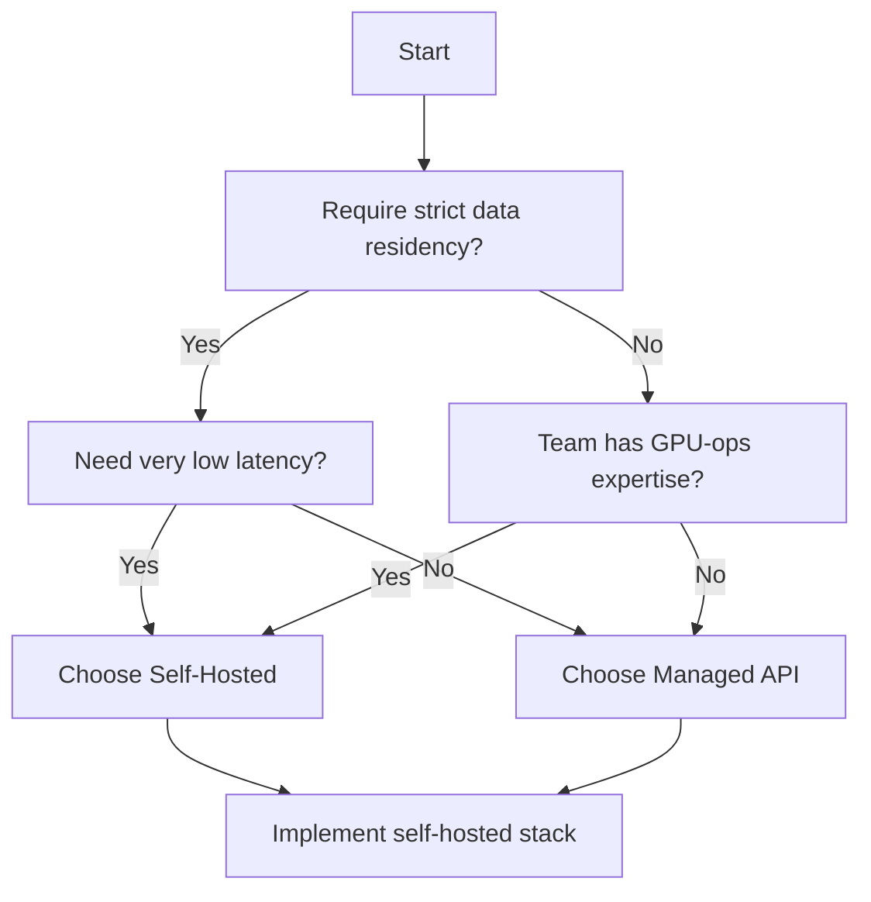

# Managed Model API vs Self‑Hosted Inference  

## Quick‑Diagnosis Table  

| Decision Factor                | Managed API (Provider‑Hosted)                                          | Self‑Hosted Inference (On‑Prem / Cloud‑Owned)                                   |
|------------------------------|------------------------------------------------------------------------|---------------------------------------------------------------------------------|
| **Operational ownership**   | Provider runs GPU fleet, scaling logic, OS patches, and health checks. | Your ops team provisions hardware, runs schedulers, applies patches, and monitors. |
| **Data control & compliance**| Data leaves your environment; you must rely on provider‑defined egress contracts. | Data stays in your network; you can enforce any regulatory boundary you control. |
| **Hardware utilization**    | Shared capacity; batch sizes are limited by provider’s quota and pricing tier. | You can size batches precisely, over‑subscribe GPUs, or reserve dedicated instances. |
| **Customization**           | Prompt‑only or limited parameter tweaks (temperature, top‑p).        | Ability to swap model checkpoints, add adapters, change tokenizers, or run LoRA updates. |
| **Reliability model**       | SLA defined by provider (e.g., high uptime); fail‑over is automatic. | You must design redundancy (multi‑zone, active‑passive, health‑checks) yourself. |
| **Skill requirements**       | Minimal; integration via HTTP/SDK.                                      | Requires Kubernetes, GPU driver management, model‑server knowledge (e.g., NVIDIA Triton). |
| **Latency profile**          | Depends on provider’s multi‑tenant queue; generally higher than a tightly tuned local stack. | Can be tuned to lower latency by colocating near downstream services and controlling batch timing. |
| **Total cost of ownership**  | Predictable usage‑based pricing plus any data‑egress fees; no capital expense. | Capital expense for GPUs plus variable OPEX (power, staffing, maintenance). |

> **Note:** The table is a diagnostic aid. Real projects should measure latency, throughput, and cost for their specific workloads before committing.  

---

## Decision Flow (Mermaid)



The diagram condenses the most common trade‑offs: data residency, latency, and operational skill set.  

---

## Architecture Responsibility Matrix  

| Layer                              | Managed API Owner | Self‑Hosted Owner |
|-----------------------------------|-------------------|-------------------|
| **Model hosting & hardware**       | Provider (fleet mgmt, GPU health) | Internal SRE / Platform team (provisioning, driver updates) |
| **Inference service (REST / gRPC)**| Provider (API gateway, auth)    | Your model server (Triton, vLLM, or custom) |
| **Scaling & autoscaling**           | Provider (elastic load)          | Your orchestration (K8s HPA, custom scaler) |
| **Monitoring & alerting**           | Provider (service health page)  | Your observability stack (Prometheus, Grafana, alerts) |
| **Security & access control**       | Provider IAM, API keys           | Zero‑trust network policy, mTLS, internal RBAC |
| **Data governance**                 | Provider‑defined contracts        | In‑house DLP, audit logs, compliance checks |
| **Versioning & updates**            | Provider releases new model versions | Your CI/CD pipeline for model artifact promotion |
| **Cost tracking**                  | Provider billing dashboard        | Internal chargeback tags (GPU‑hours, storage) |

---

## Decision Helper (Python, std‑lib only)

```python
# teaching‑only example
import os
from dataclasses import dataclass

@dataclass(frozen=True)
class InferenceContext:
    """All inputs that influence the operating model decision."""
    data_residency_required: bool
    latency_target_ms: int | None   # None means “no explicit target”
    gpu_ops_expertise: bool
    expected_monthly_token_volume: int

def decide_inference_mode(ctx: InferenceContext) -> str:
    """
    Return the recommended operating mode: ``"managed"`` or ``"self_hosted"``.
    The logic mirrors the Mermaid diagram but adds defensive checks.
    """
    # Basic sanity checks – raise early if required fields are missing.
    assert isinstance(ctx.data_residency_required, bool), "Residency flag must be bool"
    assert ctx.expected_monthly_token_volume >= 0, "Token volume cannot be negative"
    if ctx.latency_target_ms is not None:
        assert ctx.latency_target_ms >= 0, "Latency target must be non‑negative"

    # Decision tree
    if ctx.data_residency_required:
        # Residency forces control of the stack; latency becomes secondary.
        return "self_hosted"
    if ctx.latency_target_ms is not None and ctx.latency_target_ms < 100:
        # Very low latency is generally only achievable with local inference.
        return "self_hosted"
    if ctx.gpu_ops_expertise:
        return "self_hosted"
    # Default to managed when none of the constraints push toward ownership.
    return "managed"

# Example (illustrative, not executed):
# ctx = InferenceContext(True, None, False, 5_000_000)
# mode = decide_inference_mode(ctx)
# print(mode)  # → "self_hosted"
```

The helper is deliberately simple: it does **not** embed any provider‑specific pricing or SLA numbers, keeping the logic portable across clouds.  

---

## Architectural Decision Records (ADRs)  

### ADR 001 – Data Residency vs Latency  

**Context**  
A regulated financial services team processes personally identifiable information (PII) and must keep all raw data behind its firewall. The same service also requires very low response time for real‑time fraud scoring.  

**Decision**  
Deploy a self‑hosted inference stack inside the private data center, using a GPU‑accelerated model server with a LoRA‑based domain adapter.  

**Alternatives Considered**  
1. Managed API with an egress‑only contract.  
2. Hybrid approach: Managed API for non‑PII requests, self‑hosted for PII.  

**Rationale**  
*Residency* eliminates any cross‑border data movement. *Latency* can be measured directly on the internal network, giving confidence that the target is met. The hybrid option introduced routing complexity without clear cost benefit.  

**Acceptance Criteria**  
- End‑to‑end latency meets the internal target defined by the product team.  
- No raw data leaves the internal network, as verified by network flow logs that show no outbound traffic to provider IP ranges.  

---

### ADR 002 – Skill Availability vs Speed‑to‑Market  

**Context**  
An edtech startup needs to launch an adaptive‑quiz feature within a tight schedule. The team has strong product designers but only one DevOps engineer with limited GPU experience.  

**Decision**  
Adopt a managed inference API (e.g., Azure OpenAI or AWS Bedrock) for the initial launch.  

**Alternatives Considered**  
1. Build a self‑hosted stack using Kubernetes + Triton.  
2. Contract an external GPU‑ops consultancy to set up the infrastructure.  

**Rationale**  
The managed service removes the need for GPU driver maintenance, scaling logic, and model‑server configuration, fitting the short timeline. The consultancy option added procurement overhead and did not guarantee long‑term knowledge transfer.  

**Acceptance Criteria**  
- Feature released within the planned timeline.  
- Integration tests pass with an acceptable failure rate as defined by the product team.  
- Post‑launch cost analysis shows usage within the budgeted forecast.  

---

## Evaluation & Maintenance Checklist  

- **Latency verification** – Run a calibrated load test; confirm that observed latency satisfies the target defined for the project.  
- **Throughput capacity** – Ensure the system sustains the expected token volume without excessive queuing.  
- **Data‑flow audit** – Verify that no raw input leaves the trusted zone (self‑hosted) or that egress contracts are in place (managed).  
- **Patch & driver updates** – For self‑hosted, schedule regular GPU driver refresh; for managed, monitor provider release notes.  
- **Model version governance** – Tag each deployed checkpoint; keep a changelog linking business releases to model updates.  
- **Observability** – Instrument request latency, error rates, and GPU utilization; set alerts on threshold breaches.  
- **Cost reconciliation** – Reconcile monthly token usage against provider invoices; for self‑hosted, reconcile GPU‑hour billing and power consumption.  
- **Compliance re‑validation** – At each major regulatory review, confirm that the chosen operating model still satisfies jurisdictional requirements.  

---

## References  

- Microsoft – Retrieval‑augmented generation concepts. https://learn.microsoft.com/en-us/azure/foundry/concepts/retrieval-augmented-generation  
- LoRA: Low‑Rank Adaptation of Large Language Models. https://arxiv.org/abs/2106.09685
