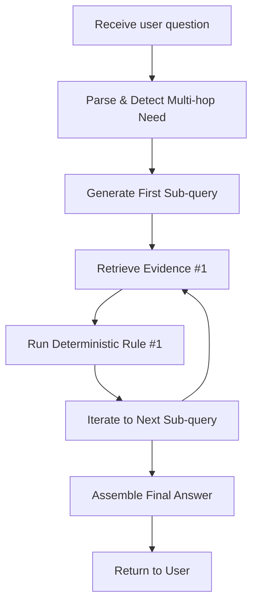

# Multi‑hop Retrieval for Enterprise Knowledge‑Driven Q&A  

## 📋 Concise Diagnosis  

| Symptom | Typical Cause | Immediate Remedy |
|---|---|---|
| Answer stops after a single paragraph | Query spans multiple knowledge islands; single‑vector lookup returns only the first island | Decompose into sub‑questions and chain retrieval hops |
| Stale regulatory numbers appear in the response | Context window contains cached documents, but the live value is governed by an external API | Add a “live‑value” hop that calls the authoritative service |
| Latency spikes when depth > 3 | Each hop launches a separate retrieval round; network and model inference accumulate | Profile per‑hop latency, enforce a cumulative budget, and consider early‑stop criteria |
| Business rule is violated despite correct evidence | Rule logic lives in deterministic code, but the LLM is asked to “reason” about it | Encode the rule as executable Python (or a policy engine) and feed its result as a system prompt |

## ⏩ Decision Flow  



The diagram shows a single loop for readability; real deployments may iterate up to a configured depth limit.

## 📐 Architecture & Responsibility Matrix  

| Component | Core Responsibility | Owner (Typical) |
|---|---|---|
| Front‑end API | Accepts raw user query, returns streamed answer | Product / Platform |
| Question Analyzer | Detects whether the query requires multi‑hop processing (e.g., multiple entities, conditional clauses) | NLP Engineering |
| Sub‑query Generator | Emits a focused retrieval prompt for each hop (e.g., “What is the Basel III definition of capital requirement?”) | Prompt Engineering |
| Retriever | Executes a vector or keyword search against the enterprise corpus; returns ranked passages | Retrieval Team |
| Evidence Chainer | Persists retrieved passages, deduplicates, orders them, and makes them available to subsequent hops | Knowledge Engineering |
| Rule Engine | Executes deterministic business rules or policy checks (e.g., “capital requirement must be ≥ 8 %”) | Compliance / Engineering |
| Live‑Value Adapter | Calls external authoritative APIs for up‑to‑date numeric values (e.g., latest stress‑test factor) | Integration Team |
| Response Composer | Merges chained evidence, rule outcomes, and live values into a coherent natural‑language answer; enforces stop‑criteria | LLM Ops |
| Monitoring & Guardrails | Tracks per‑hop latency, token usage, and compliance violations; triggers fallback if limits exceeded | SRE / Observability |

## 🧑‍💻 Teaching‑Only Python Helper (Standard Library Only)  

```python
# teaching-only: helper that decides whether to continue hopping
import time
from typing import List, Tuple

MAX_HOPS = 5           # illustrative ceiling; adjust per business policy
MAX_LATENCY_SEC = 12   # illustrative cumulative budget; adjust per SLA

def should_continue(
    hop_counter: int,
    elapsed_sec: float,
    evidence: List[Tuple[str, float]],
) -> bool:
    """
    Decide if another retrieval hop is allowed.

    Parameters
    ----------
    hop_counter: int
        Number of hops already executed.
    elapsed_sec: float
        Total wall‑clock time spent on previous hops.
    evidence: List[Tuple[str, float]]
        List of (doc_id, relevance_score) collected so far.

    Returns
    -------
    bool
        True → launch next hop; False → stop and compose answer.
    """
    # Hard stop on depth
    assert hop_counter >= 0, "hop_counter cannot be negative"
    if hop_counter >= MAX_HOPS:
        return False

    # Hard stop on latency
    assert elapsed_sec >= 0.0, "elapsed time cannot be negative"
    if elapsed_sec > MAX_LATENCY_SEC:
        return False

    # Soft stop: diminishing returns (example heuristic)
    if len(evidence) >= 2:
        # compare last two relevance scores
        _, prev_score = evidence[-2]
        _, last_score = evidence[-1]
        # stop if improvement is negligible
        if last_score - prev_score < 0.02:
            return False

    return True
```

## 📚 Illustrative Architectural Decision Records  

### ADR 1 – Choice of Retrieval Backend  

**Context**  
Enterprise knowledge bases are stored in heterogeneous formats (PDF, Confluence, relational tables). The team evaluated pure dense‑vector search (FAISS) versus a hybrid dense + BM25 approach (Elastic) for the first hop.

**Decision**  
Adopt a hybrid backend that first filters with BM25 on metadata (document type, confidentiality label) and then re‑ranks with dense embeddings.

**Consequences**  
* Improves recall for sparse regulatory terms that dense models under‑represent.  
* Adds modest per‑hop latency due to the two‑stage pipeline; this overhead is acceptable because early hops dominate the overall latency budget.

**Acceptance Criteria (illustrative)**  
* The hybrid approach must demonstrably increase recall on the internal compliance benchmark.  
* Per‑hop latency should remain within the organization’s acceptable latency budget as measured on a production‑size index.

---  

### ADR 2 – Handling Live Numerical Values  

**Context**  
Regulatory answers often need the most recent numeric factor (e.g., “latest stress‑test multiplier”). Storing such numbers in the vector store quickly becomes stale.

**Decision**  
Introduce a dedicated **Live‑Value Adapter** that detects sub‑queries matching the pattern `latest *` and triggers an HTTP call to the official regulator API. The retrieved value replaces any cached occurrence before answer composition.

**Consequences**  
* Guarantees freshness for regulated numbers, satisfying audit requirements.  
* Adds external‑service latency; a circuit‑breaker will abort the live call after a short timeout and fall back to the most recent cached value with a “⚠️ may be outdated” flag.

**Acceptance Criteria (illustrative)**  
* The live‑value path must return values that match the regulator API in the overwhelming majority of cases.  
* The fallback flag should appear only when the live call fails, and such failures should be rare enough to meet compliance expectations.

## ✅ Evaluation & Maintenance Checklist  

| ✅ Item | How to Verify | Frequency |
|---|---|---|
| Depth‑Latency Trade‑off – cumulative latency respects SLA | Automated load test that exercises the max‑depth path and records end‑to‑end time | CI on every code merge |
| Evidence Freshness – no stale regulatory doc beyond an acceptable age | Compare timestamps of retrieved passages against source metadata | Weekly audit |
| Rule Engine Correctness – deterministic outputs for known inputs | Unit tests with exhaustive edge cases (e.g., capital = 7 % should be rejected) | Nightly |
| Live‑Value Success Rate – high success ratio for API calls | Monitoring of HTTP 200 counters vs. total live‑value attempts | Real‑time alert on sustained degradation |
| Retrieval Recall – meets internal benchmark expectations | Run the benchmark suite after any index rebuild or embedding model change | Per index refresh |
| Security / Permissions – each hop respects document ACLs | Integration test that simulates a user lacking access to a confidential doc | Monthly |
| Model Hallucination Guardrail – answer always cites at least one retrieved passage | Regex check that every answer contains a citation marker (e.g., `[DocID]`) | CI |
| Documentation Sync – ADRs, architecture diagram, and config files are version‑controlled | Repo scan for drift between `architecture.md` and actual code constants | Every release |

## 📖 References  

- Microsoft RAG concepts – Azure Foundry documentation on Retrieval‑Augmented Generation  
  <https://learn.microsoft.com/en-us/azure/foundry/concepts/retrieval-augmented-generation>  

- LoRA: Low‑Rank Adaptation of Large Language Models – original paper introducing parameter‑efficient fine‑tuning  
  <https://arxiv.org/abs/2106.09685>
