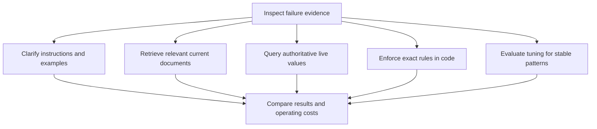

# Prompting vs RAG vs Fine-Tuning: Diagnose the Failure First

A wrong answer is an observation, not a root cause. Inspect the input, source evidence, retrieval results, tool responses, and expected output before choosing an intervention. The same symptom can come from missing context, ambiguous labels, a weak base model, or a bug outside the model. The examples and architectural decisions below are hypothetical teaching examples.

## Match the intervention to evidence

| Observed issue | Evidence to inspect | Candidate intervention |
|---|---|---|
| Instructions are unclear or the answer has the wrong style | Prompt wording, examples, instruction conflicts, and task tests | Improve prompting and evaluate the change |
| An answer needs private or changing documents | Source version, access filters, retrieval coverage, and citation support | Retrieve relevant documents and provide them as context through RAG |
| The answer needs a current numeric value | Authoritative service, timestamp, units, and response schema | Call a tool or API at request time |
| A rule must be enforced exactly | Approved rule specification, inputs, boundary cases, and authorization | Implement and test deterministic application code |
| A stable task pattern remains weak after baseline improvements | Label quality, representative examples, model capability, and held-out results | Evaluate fine-tuning against the improved baseline |

Prompting supplies instructions and examples at inference time. RAG retrieves relevant content and adds it to the model input. Fine-tuning changes learned behavior using training examples. They are composable: a tuned model can still use prompts, retrieval, and tools. None removes the need to evaluate the complete application.

Do not infer that a repetitive error came from pre-training merely because it occurs often. Check the labels, missing context, preprocessing, and task definition first. A model that cannot handle the underlying task may require a different base model rather than more prompt text or tuning.

## Decision flow

This diagram summarizes candidate interventions after diagnosis. A symptom can lead to more than one candidate. Validate each change with task-level evaluation before adopting it.



## Architecture and responsibilities

| Component | Responsibility | Evaluation focus |
|---|---|---|
| Prompt templates | Version instructions, examples, and context assembly | Task success and sensitivity to phrasing |
| Document ingestion and retrieval | Maintain source versions, access filters, indexes, and relevant excerpts | Coverage, freshness, ranking, and citation support |
| Tool execution | Fetch authoritative values and perform authorized actions | Schema, units, timestamps, errors, and authorization |
| Deterministic application logic | Enforce explicit business rules and output constraints | Boundary cases and reproducible results |
| Training and model registry | Track datasets, base versions, tuning artifacts, and evaluation evidence | Target-task improvement and regressions elsewhere |
| Orchestration and monitoring | Assemble context, route requests, and record useful diagnostics | End-to-end quality, cost, latency, and failure recovery |

For a hypothetical policy assistant, use retrieval to supply the applicable document version and citations. Use an API for a live rate, and code for an exact threshold calculation. The model may explain the result, but application logic must enforce any required rule. Retrieval does not guarantee a correct answer or regulatory compliance; source coverage, interpretation, and review still matter.

LoRA freezes base weights and learns low-rank updates to selected weight matrices. Frozen base weights do not imply unchanged behavior when the updates are applied. Evaluate target-task quality and regressions on other tasks. Where the model and deployment support merging, LoRA updates can be merged into the base weights; runtime adapter selection is a separate deployment choice. Measure latency and cost for the actual serving configuration.

## Python decision helper: teaching only

This helper maps an already diagnosed category to a candidate intervention. It does not diagnose a model, authorize an action, or decide compliance. A real investigation may produce several categories, so the function accepts multiple findings. It uses only the Python standard library.

```python
from enum import Enum


class Finding(Enum):
    UNCLEAR_INSTRUCTIONS = "unclear_instructions"
    DOCUMENT_GAP = "document_gap"
    LIVE_VALUE = "live_value"
    EXACT_RULE = "exact_rule"
    STABLE_TASK_GAP = "stable_task_gap_after_baselines"


INTERVENTIONS = {
    Finding.UNCLEAR_INSTRUCTIONS: "evaluate_prompting",
    Finding.DOCUMENT_GAP: "evaluate_rag",
    Finding.LIVE_VALUE: "query_authoritative_tool",
    Finding.EXACT_RULE: "implement_tested_code",
    Finding.STABLE_TASK_GAP: "evaluate_fine_tuning",
}


def candidate_interventions(findings: list[Finding]) -> list[str]:
    """Return unique candidates in the order the findings were supplied."""
    if not isinstance(findings, list):
        raise TypeError("findings must be a list of Finding members")
    candidates = []
    for finding in findings:
        if not isinstance(finding, Finding):
            raise TypeError("each finding must be a Finding member")
        candidate = INTERVENTIONS[finding]
        if candidate not in candidates:
            candidates.append(candidate)
    return candidates


if __name__ == "__main__":
    assert candidate_interventions([]) == []
    assert candidate_interventions([
        Finding.DOCUMENT_GAP, Finding.EXACT_RULE, Finding.DOCUMENT_GAP
    ]) == ["evaluate_rag", "implement_tested_code"]
    assert candidate_interventions([Finding.STABLE_TASK_GAP]) == [
        "evaluate_fine_tuning"
    ]
```

The explicit type checks remain active when Python assertions are disabled. The assertions demonstrate expected behavior; they are not input validation. Candidate names intentionally describe the next engineering step rather than promise a successful fix.

## Illustrative architectural decision records

### ADR 001: Retrieve changing policy documents

**Context:** A hypothetical assistant must explain policy documents that change independently of model releases.

**Decision:** Maintain a searchable source collection with versions and effective dates. Refresh it according to the application's freshness requirement, apply access filters, retrieve relevant passages, and retain citation metadata. Evaluate missing-document and conflicting-version cases. Escalate when supporting evidence is insufficient.

**Consequences:** Document updates can be delivered without retraining the model. Ingestion and retrieval add operational work and latency. A fresh index alone cannot establish that an answer is correct, complete, or compliant. Exact enforceable rules remain in tested code.

### ADR 002: Evaluate tuning for stable classification behavior

**Context:** A hypothetical classifier still makes a recurring error after task definition, labels, prompts, and supplied context have been checked.

**Decision:** Compare a tuning candidate with the improved baseline using representative, disjoint evaluation data. Track the base model, training data, and tuning configuration. Include regression cases outside the target category and keep a rollback path. Consider LoRA if the chosen model and training stack support it.

**Consequences:** Tuning may improve stable task behavior, but improvement must be demonstrated. Training data, evaluation, and model lifecycle management add cost. Small trainable updates do not guarantee preserved general performance. Tuning is not a dependable mechanism for refreshing changing facts or enforcing exact rules.

## Evaluation and maintenance checklist

- Version prompts, model configurations, data sources, and expected outputs so comparisons are reproducible.
- Measure end-to-end task success with representative examples; inspect individual failure cases as well as averages.
- For RAG, evaluate source coverage, retrieval relevance, document versions, access control, and whether citations support each factual claim.
- For tools, validate schemas, units, timestamps, and error states. Define when a cached result is acceptable; do not silently use stale data for a request requiring a live value.
- For deterministic rules, test boundary values and invalid inputs against the approved specification.
- For tuning, keep training and evaluation data separate and compare against the strongest practical baseline. Check regressions and drift before promotion.
- Measure latency and cost per successful task for the actual application. Set thresholds from its requirements rather than invented universal benchmarks.
- Keep diagnostic records limited to the information needed for investigation, with appropriate retention and data handling.

Start with the evidence, choose a candidate change, and measure the result. Keep retrieval, tool execution, rule enforcement, and learned task behavior accountable to their own tests.

## Primary references

- [Microsoft: Retrieval augmented generation and indexes](https://learn.microsoft.com/en-us/azure/foundry/concepts/retrieval-augmented-generation)
- [Hu et al.: LoRA: Low-Rank Adaptation of Large Language Models](https://arxiv.org/abs/2106.09685)
