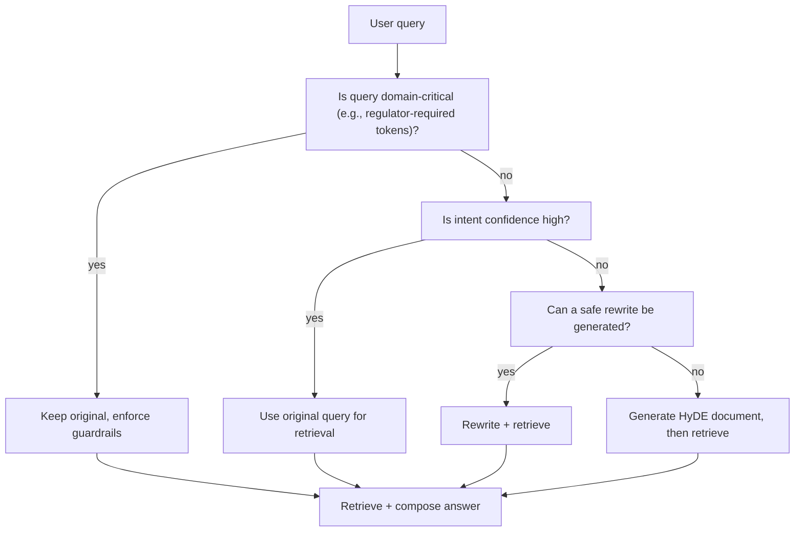

# Query Rewriting & HyDE in Retrieval‑Augmented Generation  

---  

## Diagnosis Table  

| Symptom | Likely Root Cause | Immediate Mitigation |
|---|---|---|
| Low relevance but correct intent | Query too terse or uses domain jargon unknown to the retriever | Run an **Intent Analyzer** and consider a safe rewrite (add missing qualifiers). |
| High relevance, unintended facts | HyDE synthetic document mismatches real sources | Verify HyDE output against a deterministic **Live‑Value Resolver** before composition. |
| Compliance flags on answer | Original query contains regulated entities (e.g., ticker symbols) that were altered | Preserve the exact token sequence; skip rewrite and apply rule‑based guardrails. |
| Sudden latency spikes | Both rewrite and HyDE pipelines fire for every request | Add a **Decision Helper** that selects a single strategy per query. |
| Repeated hallucinations on numeric topics | Retrieval fell back to stale cache instead of live API | Route numeric sub‑queries to an authoritative tool/API. |

---  

## Decision Flow  



---  

## Architecture & Responsibilities  

| Component | Primary Responsibility |
|---|---|
| **Input Handler** | Normalise Unicode, enforce length limits, flag regulated identifiers. |
| **Intent Analyzer** | Produce a confidence indicator using a frozen‑base LLM; does not modify model weights. |
| **Rewriter** | Generates a longer, context‑rich query while preserving identified regulated tokens. |
| **HyDE Generator** | Constructs a short answer, embeds it as a synthetic document, and returns the embedding to the Retriever. |
| **Retriever** | Performs dense/sparse search over the knowledge base; falls back to vector store if lexical match fails. |
| **Live‑Value Resolver** | Calls authoritative APIs (e.g., market data) for any numeric entity detected after retrieval. |
| **Answer Composer** | Merges retrieved passages, HyDE‑generated text, and live values; applies a template that inserts guardrail checks. |
| **Guardrails (Business Rules Engine)** | Executes deterministic code that validates compliance, rate limits, and forbidden content before the final answer is emitted. |
| **Monitoring & Logging** | Captures latency, cost, intent‑drift metrics, and flags hallucinations for human review. |

---  

## Decision Helper (Python – standard library only)  

```python
# teaching‑only
import re
from typing import Literal

def decide_strategy(query: str) -> Literal["original", "rewrite", "hyde"]:
    """
    Choose a retrieval‑augmentation strategy.

    Rules
    -----
    1. Non‑empty, printable ASCII required.
    2. If a regulated token (ticker, SSN, etc.) is present → keep original.
    3. If the Intent Analyzer would likely indicate high confidence → original.
    4. Otherwise, attempt a safe rewrite; if rewriting fails → HyDE.

    The function never contacts external services; it only analyses the string.
    """
    # 1. basic validation
    assert isinstance(query, str) and query.strip(), "query must be non‑empty"
    assert all(32 <= ord(ch) <= 126 for ch in query), "query must be printable ASCII"

    # 2. detect regulated tokens (very simple regex for illustration)
    regulated = re.search(r"\b([A-Z]{1,4}\d{0,2})\b", query)  # e.g., ticker XYZ or XYZ12
    if regulated:
        return "original"

    # 3. mock intent confidence (placeholder – real system uses a frozen LLM)
    #    Here we treat the presence of a question mark as a proxy for lower confidence.
    high_confidence = query.count("?") == 0
    if high_confidence:
        return "original"

    # 4. safe rewrite feasibility (e.g., length > 5 words → likely expandable)
    if len(query.split()) > 5:
        return "rewrite"

    # 5. fallback
    return "hyde"
```

---  

## ADR 1 – When to Apply Query Rewriting  

**Context**  
User queries often omit qualifiers that are essential for downstream compliance (e.g., “stock ticker XYZ price” must stay literal, while “latest mortgage rates” benefits from added temporal scope).  

**Decision**  
Apply a *safe rewrite* only when:  

1. No regulated tokens are detected.  
2. The Intent Analyzer suggests low confidence **and** the query is long enough to allow meaningful expansion.  

**Consequences**  

*Positive*  
- Broader lexical match improves recall.  
- Enables downstream retrieval of related contextual information without manual prompt engineering.  

*Negative*  
- Potential intent drift if the rewrite injects assumptions (e.g., adding “30‑day” when the user asked for “today”).  

**Acceptance Criteria**  

- Demonstrated improvement in relevance metrics on a held‑out test set compared with the original‑only pipeline.  
- Human reviewers confirm that rewritten queries retain the original intent in the majority of cases.  
- Measured latency remains within the operational budget for the deployment environment.  

---  

## ADR 2 – When to Use HyDE  

**Context**  
Certain domains (legal, medical, fintech) contain concise factual answers that are rarely present verbatim in the corpus, but a short synthetic answer can act as a strong anchor for retrieval.  

**Decision**  
Trigger HyDE when:  

1. The Intent Analyzer indicates low confidence **and** the query is a brief factual request (single sentence, limited token count).  
2. No regulated tokens are present.  
3. Retrieval on the original query returns an insufficient number of high‑scoring candidates.  

**Consequences**  

*Positive*  
- Synthetic document provides a dense embedding that bridges phrasing gaps.  
- Early relevance boost without additional external calls.  

*Negative*  
- Generated text may hallucinate unsupported facts, increasing reliance on the Guardrails engine.  
- Additional CPU cycles for the HyDE LLM, though limited to a single forward pass on a frozen model.  

**Acceptance Criteria**  

- Relevance metrics (e.g., nDCG) show a measurable lift for HyDE‑enabled queries relative to a baseline without HyDE.  
- Post‑guardrail factual error rate, as verified by human auditors, remains acceptably low.  
- Overall system latency for the HyDE path does not exceed the limits appropriate for the target user experience.  

---  

## Evaluation & Maintenance Checklist  

- [ ] **Unit Tests** for `decide_strategy` covering regulated token detection, confidence branches, rewrite eligibility, and HyDE fallback.  
- [ ] **Integration Tests** that mock the Intent Analyzer and verify the correct pipeline branch executes.  
- [ ] **Regression Suite**: run relevance benchmarks on a stable validation set after any LoRA update.  
- [ ] **Compliance Audits**: automatically validate that every answer containing regulated identifiers passed through the Guardrails engine.  
- [ ] **Live‑Value Validation**: for all numeric sub‑queries, confirm that values originate from authorized APIs (e.g., Bloomberg, Federal Reserve).  
- [ ] **Latency Monitoring**: record per‑stage latency; raise alerts if any stage exceeds the service‑level objective defined for the deployment.  
- [ ] **Cost Tracking**: aggregate token usage per strategy and ensure it stays within allocated budgets.  
- [ ] **Model Drift Review**: periodically compare intent confidence distributions with the latest data; adjust thresholds only after a documented evaluation.  

---  

## References  

- Microsoft RAG concepts – <https://learn.microsoft.com/en-us/azure/foundry/concepts/retrieval-augmented-generation>  
- LoRA: Low‑Rank Adaptation of Large Language Models – <https://arxiv.org/abs/2106.09685>
