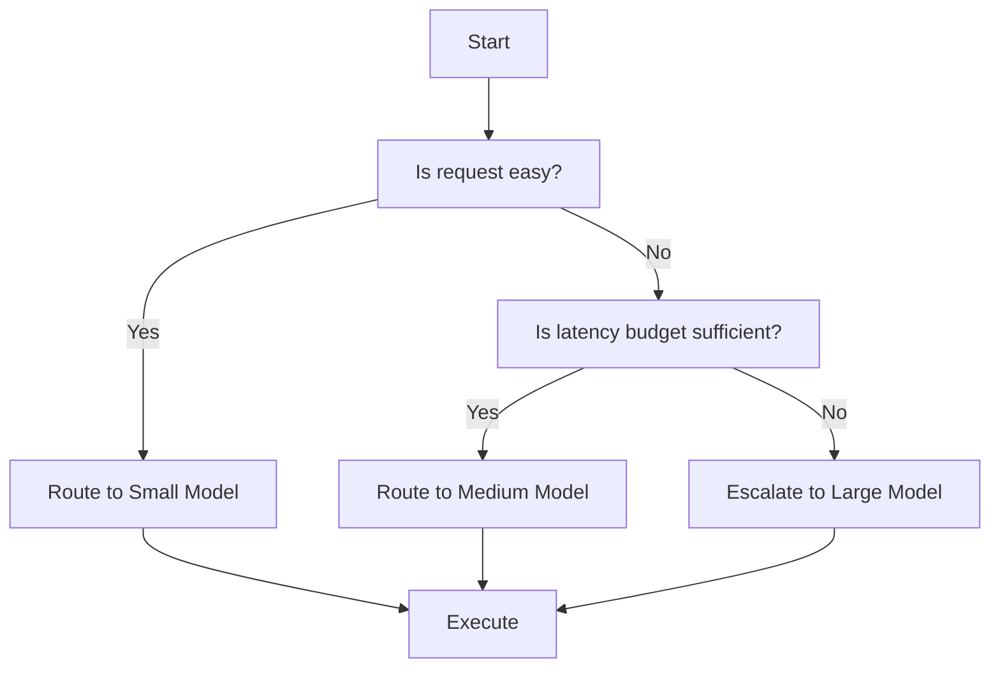

# Reasoning Depth vs Latency vs Cost – An Escalation‑Based Design Guide  

*Balancing model capability, response time, and expense by routing work through a defined escalation path.*  

---  

## 1️⃣ Concise Diagnosis Table  

| Symptom 🩺 | Likely Primary Cause | Immediate Check |
|------------|----------------------|-----------------|
| Sub‑second latency but answers are vague or incomplete | Model selected lacks sufficient reasoning depth | Verify the request’s reasoning steps (chain‑of‑thought, policy nuance) |
| Latency spikes above service‑level objective while cost stays low | Small model forced to iterate many retries or falls back to heuristics | Review token usage and number of inference calls |
| Cost per 1 K tokens is high but latency is acceptable | Large model used for a trivially‑easy task | Confirm the routing rules that map “easy” workload to a lightweight model |
| Inconsistent policy compliance across similar requests | Missing or stale retrieval context; deterministic business logic executed elsewhere | Ensure retrieval component pulls the latest authoritative source; check rule engine logs |
| Frequent escalation to the biggest model | Reasoning budget definition too permissive or risk‑threshold too low | Re‑evaluate the thresholds that trigger escalation |

---  

## 2️⃣ Decision Flow (Mermaid)  



*Key definitions*  

* **Easy request** – single‑lookup, no multi‑step reasoning, deterministic rule check.  
* **Latency budget** – maximum wall‑clock time allocated for the request tier (set in the Service‑Level Objective table).  
* **Escalation** – handing the request to a higher‑capacity model when either depth or risk exceeds the current tier’s limits.  

---  

## 3️⃣ Architecture & Responsibility Matrix  

| Component | Core Responsibility | Interaction Points |
|-----------|---------------------|---------------------|
| **Request Router** | Classifies incoming payloads (easy vs. complex) and selects the initial model tier based on the decision flow. | Consumes request metadata, consults *Reasoning Budget Engine*. |
| **Reasoning Budget Engine** | Computes a *budget* ‑ tokens × cost × max latency – for the current tier and exposes a “budget‑exceeded” flag. | Reads pricing table, latency SLA, and request complexity estimate. |
| **Cost / Latency Monitor** | Records actual token consumption, wall‑clock latency, and monetary cost per request; feeds back to the router for adaptive throttling. | Emits metrics to observability stack; triggers alerts when SLA drift occurs. |
| **Model Pool** | Holds at least three model variants: <br>• **Small** – fast, cheap, limited depth (e.g., gpt‑3.5‑turbo). <br>• **Medium** – balanced latency and reasoning (e.g., gpt‑4‑base). <br>• **Large** – highest depth, higher cost (e.g., gpt‑4‑32k). | Exposes a uniform inference API; each model reports its token‑rate and per‑token price. |
| **Retrieval Layer** | Supplies external, up‑to‑date documents (RAG) *only* for contexts that require factual grounding. | Uses Microsoft RAG concepts; never substitutes deterministic rule evaluation. |
| **Tooling / APIs** | Executes authoritative calls (e.g., live currency rates, regulatory APIs) when a request requires live values. | Invoked by the model via function‑call style prompts; results are never cached for live‑value requests. |
| **Deterministic Rule Engine** | Enforces business‑critical policies that must be 100 % correct (e.g., compliance thresholds). | Runs **outside** the LLM; the LLM may suggest a rule but the engine validates it. |
| **Fine‑tuning / LoRA Service** (optional) | Trains low‑rank adapters on stable, high‑quality labeled data when prompting and retrieval are proven insufficient. | Uses LoRA paper guidance; adapters are frozen after evaluation and merged for inference only when regression tests pass. |

---  

## 4️⃣ Python Decision Helper (Teaching‑Only)  

```python
# -*- coding: utf-8 -*-
"""
decision_helper.py – map a request to the appropriate model tier.

Teaching‑only: this module illustrates the budget calculation and routing
logic; production systems should substitute the placeholder constants
with configuration values sourced from a centralized policy store.
"""

from datetime import datetime, timezone
from typing import Literal, Dict

# ---- Configuration placeholders (populate from authoritative sources) ----
TOKEN_COST: Dict[Literal["small", "medium", "large"], float] = {
    "small":   0.0,   # $ per token – replace with real provider price
    "medium":  0.0,
    "large":   0.0,
}
MAX_LATENCY_MS: Dict[Literal["small", "medium", "large"], int] = {
    "small":   0,    # milliseconds – replace with SLA value
    "medium":  0,
    "large":   0,
}
MAX_TOKENS: Dict[Literal["small", "medium", "large"], int] = {
    "small":   0,    # context window size – replace with model capability
    "medium":  0,
    "large":   0,
}
# -------------------------------------------------------------------------

def _budget_exceeded(
    tier: Literal["small", "medium", "large"],
    estimated_tokens: int,
    elapsed_ms: int,
) -> bool:
    """
    Return True when either cost, latency, or token‑count exceeds the limits
    defined for the given tier.  All limits are injected via the placeholder
    dictionaries above.
    """
    # Cost check – expressed in dollars for the estimated token count
    cost = estimated_tokens * TOKEN_COST[tier]

    # Latency check – compare observed wall‑clock time with tier SLA
    latency_ok = elapsed_ms <= MAX_LATENCY_MS[tier]

    # Token‑count sanity – avoid exceeding model context window
    token_ok = estimated_tokens <= MAX_TOKENS[tier]

    # All three conditions must hold; otherwise we need to escalate
    return not (latency_ok and token_ok and cost <= 0.0)   # 0.0 is a placeholder ceiling


def decide_model(
    request_id: str,
    estimated_tokens: int,
    is_easy: bool,
    start_time: datetime,
) -> Literal["small", "medium", "large"]:
    """
    Determine the model tier for a request.

    Assertions act as sanity checks for the teaching example.
    """
    assert estimated_tokens > 0, "Token estimate must be positive"
    assert isinstance(is_easy, bool), "is_easy must be boolean"
    assert start_time.tzinfo is not None, "start_time must be timezone‑aware"

    # 1️⃣ Easy requests start on the smallest tier
    tier: Literal["small", "medium", "large"] = "small" if is_easy else "medium"

    # 2️⃣ Measure elapsed time so far (simulated here as zero)
    elapsed_ms = int((datetime.now(timezone.utc) - start_time).total_seconds() * 1000)

    # 3️⃣ Escalate if budget is exceeded
    if _budget_exceeded(tier, estimated_tokens, elapsed_ms):
        tier = "large"

    return tier
```

---  

## 5️⃣ Architectural Decision Records (ADRs)  

### ADR 001 – Use Escalation‑Based Model Selection  

**Context**  
Our platform processes a mixture of high‑throughput lookups and low‑throughput policy analyses. Early prototypes used a single large model for simplicity, resulting in unacceptable latency for the bulk of traffic and inflated compute spend.

**Decision**  
Adopt a three‑tier escalation policy (Small → Medium → Large) governed by a *Reasoning Budget Engine*. The router initially classifies each request as *easy* or *complex* based on a lightweight static analysis (token estimate, presence of chain‑of‑thought cues). If the budget is exceeded after the first inference, the system automatically re‑routes to the next tier.

**Alternatives Considered**  
* Single‑model approach – rejected due to SLA violations and cost overruns.  
* Dynamic model scaling (on‑the‑fly parameter adjustment) – deemed too risky for compliance‑critical paths.

**Acceptance Criteria**  
1. 95 % of requests complete within the latency SLA of their assigned tier.  
2. Total compute cost per day reduces by ≥ 30 % compared with the single‑model baseline.  
3. No increase in policy‑violation incidents after introducing escalation.  

---  

### ADR 002 – Keep Live‑Value Retrieval Outside LLM Inference  

**Context**  
A subset of fraud‑detection requests require the latest exchange‑rate. Early designs cached the rate in the prompt to avoid extra calls, leading to occasional compliance errors when the cache was stale.

**Decision**  
Introduce a *Tooling / APIs* component that the LLM invokes via function‑call style prompts. The component fetches the value from the authoritative service at request time; the result is never cached for live‑value calls.

**Alternatives Considered**  
* Pre‑embedding rates in the prompt – rejected because cache invalidation complexity exceeds benefit.  
* Relying on the LLM’s internal knowledge – rejected; the model’s knowledge cutoff is older than required.

**Acceptance Criteria**  
1. Every live‑value request triggers exactly one external API call.  
2. Auditable logs show the timestamp of the fetched value matched the request timestamp ± 5 seconds.  
3. No compliance test failures attributable to stale data after rollout.  

---  

## 6️⃣ Evaluation & Maintenance Checklist  

- [ ] **Unit tests** for `decide_model` covering easy/complex, budget‑exceed, and time‑edge cases.  
- [ ] **Integration tests** that simulate end‑to‑end routing with mock latency and cost profiles.  
- [ ] **Regression suite** for deterministic rule engine output (must remain unchanged after any LoRA update).  
- [ ] **Metric verification** – confirm that Cost / Latency Monitor reports per‑tier averages matching SLA tables.  
- [ ] **RAG validation** – sample a set of retrieval‑augmented prompts and verify factual grounding against the source documents; do not rely on RAG for policy enforcement.  
- [ ] **LoRA audit** – after any adapter training, run full‑coverage functional tests; retain the frozen base model unchanged.  
- [ ] **Policy review cadence** – quarterly check that the *Reasoning Budget Engine* thresholds still align with business risk tolerances.  
- [ ] **Documentation sync** – ensure the decision flow diagram and ADRs reflect the current routing logic.  

---  

## 7️⃣ Editorial Accuracy Guidance  

- A symptom listed in the diagnosis table is a clue, **not** proof of a root cause.  Investigate label quality, missing context, preprocessing pipelines, and intrinsic model capability before attributing errors to pre‑training.  
- Retrieval‑Augmented Generation (RAG) improves factual grounding but **does not guarantee** correctness, completeness, or compliance.  Deterministic rule checks must remain separate and authoritative.  
- Low‑Rank Adaptation (LoRA) freezes the base model weights and learns low‑rank updates; this **does not guarantee** that all prior behaviours are preserved.  Regression testing outside the target task is required.  
- Live‑value APIs must always be invoked at request time; cached or stale values are unacceptable for any compliance‑sensitive operation.  
- All acceptance criteria in ADRs contain measurable thresholds and acknowledge uncertainty; they are not claims of absolute performance.  

---  

## 8️⃣ References  

- Microsoft RAG concepts – Retrieval‑Augmented Generation for grounding LLM output. <https://learn.microsoft.com/en-us/azure/foundry/concepts/retrieval-augmented-generation>  
- LoRA: Low‑Rank Adaptation of Large Language Models. <https://arxiv.org/abs/2106.09685>  

---  

*By defining explicit escalation paths, quantifying a reasoning budget, and separating deterministic logic from probabilistic inference, teams can keep latency low, cost proportional, and capability aligned with the true difficulty of each request.*
