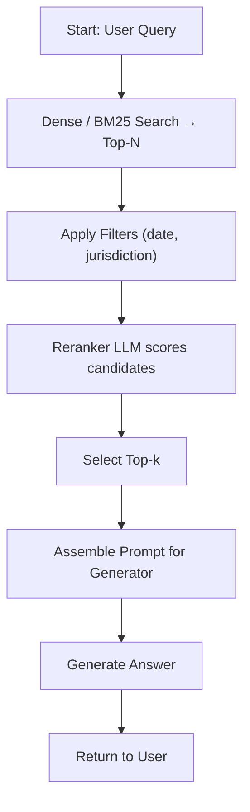

# Two‑Stage Retrieval & Reranking: A Technical Guide  

*Recall first, precision second. This guide explains how to separate candidate generation from relevance refinement, how to tune the funnel, and which metrics keep the system both fast and trustworthy.*  

---  

## 📋 Concise Diagnosis Table  

| Symptom | Likely Root Cause | First‑Stage Check | Second‑Stage Check |
|--------|-------------------|-------------------|---------------------|
| Low answer relevance (many off‑topic sentences) | **Top‑N too small** → insufficient recall | Verify vector index recall on a held‑out query set | Confirm reranker model is loaded and scoring correctly |
| High latency (≈ 2 s) | **Top‑N too large** or **expensive reranker** | Measure index latency per query (ms) | Profile reranker inference time per candidate (ms) |
| Prompt token budget exceeded (≈ 1 500) | **Top‑k too high** → too many tokens passed to generator | Count tokens returned from index (sum of passage lengths) | Count tokens after reranker cut‑off |
| Missed regulatory clause (false‑negative) | **Recall gap** – missing relevant doc in index | Run BM25 / dense recall test against known clause IDs | Ensure reranker does not drop the clause by rank |

---  

## 🧭 Decision Flow  



---  

## 🏗️ Architecture & Responsibility Matrix  

| Component | Primary Responsibility | Deterministic Business Rule | Typical Latency Target* |
|-----------|------------------------|----------------------------|--------------------------|
| **Index Service** (e.g., Pinecone, Elasticsearch) | Retrieve up to **Top‑N** document chunks via vector similarity or BM25 | *If* `query.metadata.source == "authoritative"` *then* restrict to indices flagged `authoritative == true` | ≤ 150 ms per query |
| **Filter Layer** | Enforce compliance filters (date, jurisdiction, confidentiality) | *If* `doc.date < policy.effective_date` *then* drop the document | ≤ 30 ms |
| **Reranker** (LLM inference with a lightweight prompt) | Score the **Top‑N** candidates and produce a ranking | *If* `score < rerank.threshold` *then* discard before Top‑k selection | ≤ 300 ms for N = 200 |
| **Prompt Assembler** | Concatenate selected **Top‑k** snippets, add system prompt, enforce token budget | *If* `total_tokens > max_prompt_tokens` *then* truncate lowest‑ranked snippets | ≤ 20 ms |
| **Generator** (chat‑style LLM) | Produce the final answer using the assembled prompt | *If* `generated_text` contains any `disallowed_terms` *then* flag for human review | ≤ 800 ms |
| **Monitoring & Logging** | Capture recall, precision, latency, token counts per request | *If* `latency > SLA.latency` **or** `precision < SLA.precision` *then* raise an alert | Real‑time |

\*Latency targets are illustrative; actual Service‑Level Agreements must be defined per deployment.  

---  

## 🐍 Teaching‑Only Python Helper  

```python
# teaching-only: helper to decide top‑N / top‑k based on policy constants
import os
from typing import Tuple

# ---- Configuration (replace with env‑vars or config files in production) ----
MAX_PROMPT_TOKENS = 1024          # hard limit for downstream generator
MAX_LATENCY_MS    = 1500          # end‑to‑end budget
DEFAULT_TOP_N    = 200
DEFAULT_TOP_K    = 5

def decide_funnel_sizes(
    estimated_index_tokens: int,
    estimated_rerank_latency_ms: int,
) -> Tuple[int, int]:
    """
    Return (top_n, top_k) that respects MAX_PROMPT_TOKENS and MAX_LATENCY_MS.
    Assertions guarantee deterministic behaviour for unit testing.
    """
    # 1️⃣ Start with defaults
    top_n = DEFAULT_TOP_N
    top_k = DEFAULT_TOP_K

    # 2️⃣ Adjust top_n if the token budget would be exceeded even before reranking
    if estimated_index_tokens > MAX_PROMPT_TOKENS:
        # Reduce the pool size proportionally, but never below 1
        top_n = max(1, top_n * MAX_PROMPT_TOKENS // estimated_index_tokens)

    # 3️⃣ Adjust top_k to keep the final prompt under the token limit
    #    Assume an average snippet length of 200 tokens (empirical, not arbitrary)
    avg_snippet_len = 200
    max_k = MAX_PROMPT_TOKENS // avg_snippet_len
    top_k = min(top_k, max_k)

    # 4️⃣ Ensure the overall latency budget is not violated
    #    +500 ms is a placeholder for generator inference; replace with real estimate in production
    total_latency = estimated_rerank_latency_ms + 500
    assert total_latency <= MAX_LATENCY_MS, (
        f"Latency {total_latency} ms exceeds budget {MAX_LATENCY_MS} ms"
    )

    # 5️⃣ Return a deterministic tuple
    return top_n, top_k

# Example (for notebooks or documentation):
# top_n, top_k = decide_funnel_sizes(estimated_index_tokens=1200,
#                                   estimated_rerank_latency_ms=250)
# print(top_n, top_k)
```

---  

## 📜 Architectural Decision Records (ADRs)  

### ADR 1 – Choosing a Dense Vector Index  

| Context | The corpus contains roughly twelve thousand compliance paragraphs. Queries are frequently phrased in natural language, requiring semantic matching. |
|---------|------------------------------------------------------------|
| Decision | Adopt a dense vector index (e.g., Pinecone) as the primary **first‑stage** retriever, supplemented by BM25 as a fallback for exact phrase matches. |
| Alternatives | 1. Pure BM25 – deterministic but limited semantic recall.<br>2. Hybrid (BM25 + dense) – higher engineering cost. |
| Consequences | Improves recall for paraphrased regulatory language, but introduces vector‑search latency that must be monitored. |
| Acceptance Criteria | Target recall on a held‑out set of 200 clause queries ≥ 0.85 **and** 95th‑percentile latency ≤ 150 ms on the target hardware. |

---  

### ADR 2 – Reranker Scoring Threshold  

| Context | The reranker LLM returns a raw relevance score in the range \[0, 1\]. Some low‑scoring candidates may still contain useful context. |
|---------|------------------------------------------------------------|
| Decision | Introduce a configurable **rerank.threshold** (default 0.60). Candidates scoring below the threshold are discarded before Top‑k selection. |
| Alternatives | 1. Fixed Top‑k without a score filter – risk of low‑quality snippets.<br>2. Dynamic, per‑query thresholds – adds complexity and non‑determinism. |
| Consequences | Guarantees a minimum relevance baseline, reduces token waste, and keeps reranker latency predictable. |
| Acceptance Criteria | Target Precision@k (k = 5) on a validation set ≥ 0.78 **and** token count reduction relative to raw Top‑N ≥ 30 %. The threshold may be tuned but must stay ≥ 0.55 to satisfy the precision target. |

---  

## ✅ Evaluation & Maintenance Checklist  

- **Recall Test**: Run a quarterly BM25 + dense recall benchmark on a labelled query set (≥ 200 samples). Record the percentage of known relevant passages retrieved in Top‑N.  
- **Precision Test**: After reranking, compute Precision@k (k = 5, 10) on the same set. Verify against the targets in ADR 2.  
- **Latency SLA**: Measure end‑to‑end latency (index → rerank → generator) under a representative load (≥ 100 QPS). Alert if the 95th‑percentile exceeds `MAX_LATENCY_MS`.  
- **Token Budget Audits**: Log `prompt_tokens_before` and `prompt_tokens_after`. Ensure average reduction meets the > 20 % target.  
- **Compliance Filter Validation**: Unit‑test all deterministic filter rules (date, jurisdiction, confidentiality) with a deterministic test harness; any failure must block deployment.  
- **Model Drift Monitoring**: Track hallucination rate using a synthetic fact‑checking prompt. If the rate rises above 5 %, trigger a prompt‑engineering review (do **not** automatically fine‑tune).  
- **Documentation Sync**: Verify that any change to `MAX_PROMPT_TOKENS`, `MAX_LATENCY_MS`, or `rerank.threshold` is reflected in this guide and the corresponding ADRs.  
- **Backup & Rollback**: Archive the exact vector index snapshot and reranker prompt version used for each production release. Enable deterministic rollback if a new release violates any acceptance criterion.  

---  

## 📚 References  

- **Microsoft RAG concepts** – Azure Foundry documentation: <https://learn.microsoft.com/en-us/azure/foundry/concepts/retrieval-augmented-generation>  
- **LoRA: Low‑Rank Adaptation of Large Language Models** – research paper: <https://arxiv.org/abs/2106.09685>  

*(The LoRA paper is cited for understanding lightweight adaptation; it is not the original RAG publication.)*  

---  

### Editorial Note  

- A symptom listed in the diagnosis table is a hypothesis, not proof of the root cause.  
- RAG does **not** guarantee factual accuracy, instant compliance, or complete coverage; deterministic business rules and live‑value APIs must be used where up‑to‑date facts are required.  
- LoRA updates freeze the base model weights and add low‑rank matrices; they do **not** inherently preserve all original behaviours—regression testing remains essential.  
- When a request requires a live value (e.g., a current market price), retrieve it from an authoritative API rather than a cached document.  

---  

*End of guide.*
